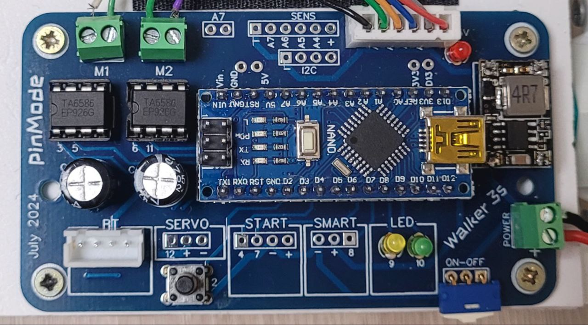
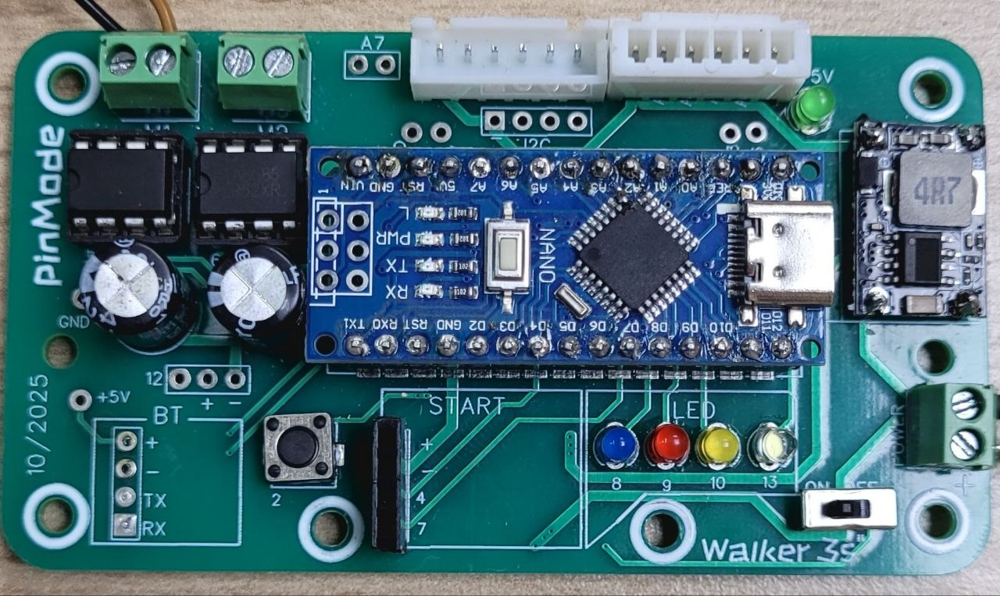

# Walker3s: multi-pupose PCB based on Arduino nano

## Многофункциональная плата для создания роботов на Arduino nano:
* Следования по линии
* Шагающих роботов
* Мини-сумо 10*10
* Лабиринта
* Ралли по коридору (Roborace)

Плата содержит:
* Импульсный стабилизатор напряжения 5В, 3А
* Драйверы коллекторных моторов TA6586 - 2шт
* Тактовая кнопка - 1шт
* Светодиоды управляемые -2/4 шт
* Разъемы для подключения:
  * модуля Bluetooth
  * сервомотора
  * стартового модуля
  * адресной ленты типа WS2812
  * датчиков - 2шт
  * I2C устройства -1шт
* Перемычку для включения измерителя питающего напряжения
* Защиту от переполюсовки
* Схему коммутации питания

## Синяя версия (2024)
### [Распиновка](/src/readme.md) 

## Зеленая версия (2025)
### [Распиновка](/src/readme.md) 
